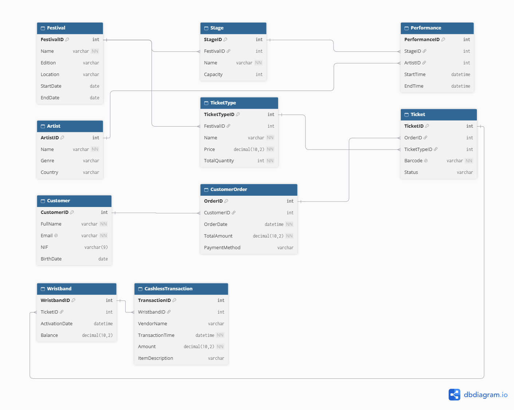

# Database Design: FestPass

## Model Overview
FestPass is a relational database designed to manage the complete ecosystem of a modern music festival. The model maps the event lineup, ticketing operations, and financial tracking of on-site consumption through cashless technology (RFID wristbands).

## Entity-Relationship Diagram (ERD)

## Schema Structure
The relational model consists of 10 tables, divided into 4 operational blocks:
1. **Lineup & Venue:** `Festival`, `Stage`, `Artist`, `Performance`
2. **Ticketing (Products):** `TicketType`
3. **Sales & Customers:** `Customer`, `CustomerOrder`, `Ticket`
4. **Cashless Operations:** `Wristband`, `CashlessTransaction`

## Modeling and Normalization Justification (3NF)
The database was designed strictly adhering to the 3rd Normal Form (3NF) to eliminate redundancies and ensure data integrity:

* **Customer Centralization:** User data (`Customer`) was separated from tickets (`Ticket`) and invoices (`CustomerOrder`). If a customer purchases 4 tickets, their personal information (Name, Email, Tax ID) is stored only once, avoiding update anomalies.
* **Real-time Operations:** The `Ticket` table generates unique barcodes, linking to the order via a Foreign Key (`OrderID`). 
* **Historical Traceability:** To maintain operational and audit integrity, the wristband (`Wristband`) relates in a `1:N` logic with the ticket. This allows for the technical cancellation and reissuing of lost wristbands at the venue without deleting the financial history in the consumption table (`CashlessTransaction`).

---
*The complete SQL code for creating the tables and constraints can be found in the [schema.sql](schema.sql) file.*